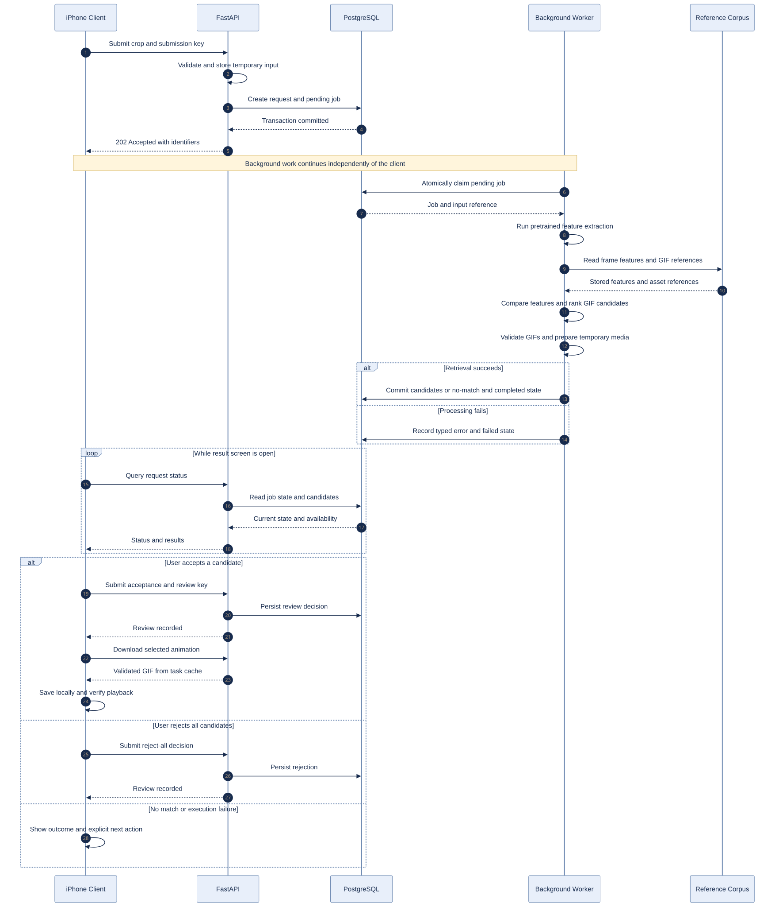

# MemeRetrieve architecture

## W07 implementation

The [current W07 data-flow diagram](../submissions/week07/assets/10-w07-system-flow.png) has an [editable Mermaid source](../submissions/week07/assets/w07-system-flow.mmd). The captured Windows profile runs native PostgreSQL 16.15 in place of the Docker database described below; the API, database schema, independent worker and retrieval path are the same. See [fresh evidence](../submissions/week07/README.md).

The current demo is a same-origin web client served by FastAPI. Host Python runs the API and an independent database-backed worker; Docker runs PostgreSQL 16. The API stores the uploaded crop and commits request/job rows before returning 202. The worker claims pending jobs, invokes `services/retrieval/`, and persists candidates or a typed failure. Polling displays pending, running, completed, or failed. Completed searches distinguish candidates from no_candidates. Review and GIF download are separate outcomes.

The corpus contains 12 Google Noto Animated Emoji GIFs with provenance and checksums in [the catalog](demo-corpus.json). CPU CLIP ViT-B/32 is pinned to `37000f5cdccec47a3f6f83142bff131370757470`. Eight frames per GIF produce 96 indexed vectors. Fresh query inference ranks distinct GIFs by best-frame cosine similarity; the experimental 0.82 threshold is not a calibrated confidence. Model/index versions and manifest checks protect against stale indexes.

PostgreSQL stores reference assets, requests, jobs, candidates, and reviews. API and worker share persistent host input/reference paths. Submission and review keys support idempotent replay and conflict detection. Logs carry request/job IDs. See [backend contracts](backend-guide.md) and [local startup](local-demo.md).

W07 accepts an already cropped screenshot through the browser. Native iOS collection, automatic cropping, internet search, WeChat export, broad retrieval evaluation, and physical iPhone saving remain outside this milestone. Fully containerized model inference is not the verified profile. Author-reported live evidence is in [the verification record](local-demo-verification.json); fresh integration checks and team acceptance must be distinguished from that record.

## Historical W04 proposal

The following proposal is retained for traceability. Its planned corpus sizes, native workflow, evaluation design, diagrams, and deployment assumptions describe W04 intentions, not W07 completion. The [W04 submission](../submissions/week04/README.md) remains the historical milestone entry.

# MemeRetrieve - Architecture and Semester Plan

**Milestone:** W04 Team Architecture Proposal and Project Plan

**Status:** proposed design; implementation and retrieval performance not yet verified

**Working project title:** MemeRetrieve: Screenshot-to-Animated-Meme Recovery

**Team:** Memeory

**Team leader:** Jiongle He (21321732)

## 1. Problem framing

An iPhone user browsing Douyin comments sees an animated meme they want to reuse but cannot obtain its media file. A screenshot preserves a frame, not the animation. Moving between search pages, downloads, and a collection interrupts browsing and may produce only static or similar images.

MemeRetrieve separates quick screenshot collection from later recovery and review. The user selects a target, searches for an existing animation, confirms a candidate, and saves a playable GIF locally. The first operational context is one user and one phone with a personal computer available for search sessions. Offline collection is core; immediate search availability is not promised.

The initial buildable baseline searches a curated GIF corpus, not the whole internet. The broader product motivation remains real-world screenshot recovery, but a corpus demonstration does not establish coverage of arbitrary Douyin memes. The team will compare the workflow with a manual search baseline and measure recovery and user effort separately.

## 2. Scope and success conditions

| Priority | Included behavior |
|---|---|
| Core | Local screenshot inbox; manual crop; one target per request; persisted request/job; live pretrained visual inference; curated-corpus retrieval; validated GIF candidates; visible status; human review; local download/playback; explicit failure/retry |
| After core integration | OCR-assisted ranking; device-validated shortcut or share collection; one verified external source; automatic crop suggestions; limited batching; tested WeChat export |
| Excluded | Multi-user accounts, cloud personal libraries, cross-device sync, a mini-program, animation generation, model training, vector databases, unrestricted web coverage, earliest-source attribution, production uptime |

The reference corpus will initially target 50-100 GIFs that the team owns or has permission to use for this purpose. This is a planned collection size, not an existing dataset. Corpus content, usage permission, provenance, and processing must be documented before retrieval implementation. GIF is the initial output; other formats require separate validation.

The minimum MVP accepts a real crop, runs a persisted background task with real pretrained inference, retrieves actual corpus media, records review, and saves a playable file on the phone. Out-of-corpus inputs may produce no match. A completed search is not a confirmed recovery; a confirmed recovery is not proof of local saving.

The W07 course slice demonstrates live input, persistent state, worker/AI processing, stored results, and a status/log signal. If a simpler client replaces the native app, the demo must disclose the missing native collection/save behavior.

## 3. Primary workflow and exceptions

1. The user intentionally collects a screenshot in a phone-local inbox, independently of the backend.
2. The user selects one target and confirms a manual crop. The original stays on the phone.
3. The phone submits the crop, optional keywords, and a stable client submission key.
4. The API validates and stores a temporary input, then transactionally creates a request and pending job. It acknowledges only committed records.
5. The worker claims a job, extracts pretrained visual features, searches the reference corpus, ranks GIFs, and validates candidate media.
6. The worker persists up to three candidates or a no-candidate outcome and finalizes the job. Technical errors finalize a failed execution.
7. The phone polls status while open and refreshes after reopening. The user accepts one candidate or rejects all.
8. The phone downloads a selected file and marks it saved only after a successful local write and playback check.

When the computer is unavailable, the item remains collected locally until submission is possible. A lost acceptance response is recovered with the same submission key; it does not create a second search. Reusing a key with changed content is a conflict. Changed crops or keywords create a new request.

Explicit retry creates a new execution only for a failed request, preserving prior errors. If a completed request's media expires, the phone submits its retained crop with a **new submission key**, creating a new request linked to the same local item. Reusing the old key returns historical state. A failed phone download does not erase the review or mark the item saved.

## 4. Architecture and component boundaries

### 4.1 System architecture

Figure 1 shows deployment and storage boundaries. AI inference and corpus ranking are modules inside the worker process, not separately deployed services. Dashed external-source connections are a conditional extension.

| Component | Responsibility | State and failure behavior |
|---|---|---|
| iPhone client | Collect, crop, submit, poll, preview, review, save | Local files/metadata survive app restart and backend disconnection |
| FastAPI | Validate input, persist submissions, expose state/media, record review/retry | Does not perform expensive retrieval in the request cycle |
| PostgreSQL | Store corpus metadata, requests, jobs, candidates, decisions | Operational truth; logs do not replace persistent records |
| Worker | Claim jobs, invoke inference, rank GIFs, validate/cache media, finalize results | Bounded execution; records completion, no match, or typed failure |
| AI and retrieval modules | Encode images and compare corpus frames; optionally add OCR cues | Versioned outputs; similarity is not a probability of correctness |
| Reference directory | Retain permitted original GIFs, sampled frames, and feature arrays | Persistent project reference data; separate from temporary task media |
| Temporary directory | Hold crops and candidate transport copies | Seven-day terminal-job retention, with explicit expiry |

The backend uses FastAPI, PostgreSQL, SQLAlchemy, Alembic, and a database-backed worker on one personal computer. API and worker are separate processes with access to shared file volumes. The initial worker handles one job at a time; no broker, GPU server, or vector database is assumed.

The current [starter architecture](starter-architecture.md) contains a separate internal AI service. This proposal instead keeps pretrained inference behind a worker module interface to simplify the single-computer baseline and avoid unnecessary network/process management for local image encoding. The API/database/worker boundaries remain explicit. Starter adaptation must map the existing routes/models and retain reproducible deployment and verification. The inference interface can be exposed over HTTP if a later course requirement specifies a separate AI service; it will remain outside the user request cycle.

SwiftUI is the intended client, conditional on Mac/Xcode, signing, and device access. The proposed local metadata store is SQLite with original screenshots and saved GIFs in the app's document directory. Initial backend access is over a local network with a device token. Remote access and protected transport require separate validation.

### 4.2 Asynchronous request sequence

Figure 2 separates immediate persistence/acknowledgment from later worker execution. Operational logs carry request/job IDs. Closing the client stops polling, not the worker.

All figures are editable Mermaid diagrams. Their `.mmd` source and `.svg` preview are kept in [docs/figures](figures/README.md); labels and captions are in English. These figures describe a proposed design, not measured behavior.

## 5. Persistence model

### 5.1 Computer-side entities

| Entity | Proposed key fields | Purpose and constraints |
|---|---|---|
| `reference_assets` | UUID PK; unique `sha256`; `title`; optional tags; `source_reference`; `permission_note`; `gif_path`; `frame_count`; `frame_manifest_path`; `feature_path`; `model_version`; `sampling_version`; `corpus_version`; `created_at` | Catalog of permitted, verified corpus GIFs and reproducible frame/features. Paths refer to persistent files |
| `search_requests` | UUID PK; unique `client_submission_key`; `client_item_id`; `input_path`; `input_sha256`; optional `user_keywords`; `created_at` | Immutable input; repeated keys must match image and keywords |
| `search_jobs` | UUID PK; `request_id` FK; `attempt_no`; nullable unique `client_retry_key`; `status`; nullable `result_kind`; `query_feature_path`; optional OCR clue fields; `model_version`; `ranking_version`; `corpus_version`; `started_at`; `finished_at`; `error_code`; bounded `error_detail` | One execution attempt; unique request/attempt pair; versions explain how retrieval was performed |
| `candidates` | UUID PK; `job_id` FK; nullable `reference_asset_id` FK; `rank`; `similarity_score`; `source_reference`; `format`; `frame_count`; `local_cache_path`; `cache_expires_at`; `verified_at` | Ranked, validated animation from a job; corpus candidates require an asset reference |
| `review_decisions` | UUID PK; `job_id` FK; nullable `candidate_id` FK; unique `client_review_key`; `decision`; `created_at` | Immutable acceptance/reject-all events; a correction appends a decision |

A reference asset may appear in many candidates across searches. A request may have multiple attempts, each with its own candidates and reviews. Nullable asset references support a future external adapter, not an implemented external source.

Required foreign keys, validated status/decision values, and uniqueness constraints use versioned migrations. Add a unique job/rank constraint and enforce at most one active job per request. Timestamps are stored in UTC and displayed in local time. Nonterminal jobs have no result kind; completed jobs have `candidates` or `no_candidates`; failed jobs have an error.

Acceptance requires a candidate from the same job. Reject-all has no candidate ID. Schema and application validation must enforce this relationship; unrelated foreign keys alone are insufficient. Reused review/retry keys with different payloads are conflicts. The latest attempt is derived from attempt number rather than duplicated on the request.

### 5.2 Phone-side records

`CollectionItem` stores a local ID, screenshot/crop paths, creation time, optional keywords, and remote request IDs. `SavedMeme` stores its ID, source collection item, actual file path, source reference, selected candidate ID, and save time. SQLite stores metadata; local files store images/GIFs. A review record does not prove a file exists on the phone.

### 5.3 File ownership and retention

| Storage class | Retention and ownership |
|---|---|
| Original screenshots and saved personal GIFs | Phone-local; retained until user deletion |
| Curated reference GIFs, sampled frames, and embeddings | Persistent computer-side project corpus with documented permission; versioned and retained for reproducibility, subject to source removal/permission changes |
| Input crops, query features, and candidate transport copies | Temporary job data; initial proposed retention is seven days after terminal state |
| Corpus/job/result/review metadata | Retained for semester review; bounded fields and source/version references |

The reference corpus is an explicit exception to temporary computer-side media retention. It is not a cloud library of users' personal screenshots. Large GIF collections, model weights, feature arrays, secrets, and caches are not committed to Git. Commit a small corpus manifest, preparation instructions, version/checksum metadata, and permission records; exact corpus reproduction depends on distributing permitted assets through an agreed accessible channel.

Expired task files produce clear availability/expiry responses without erasing historical outcomes. A worker startup sweep handles terminal-job expiry and orphaned uploads; if the computer is offline, cleanup resumes on startup. Active-job files are not removed. API/worker share explicit input, cache, and reference paths.

Logs include request/job IDs, stages, duration, and bounded error codes. They exclude images, secrets, and raw sensitive screenshot text. Counters and latency summaries derive from persisted records.

## 6. State transitions and responsibility

| Record/action | Owner | Evidence retained |
|---|---|---|
| Local collection and target selection | Phone/user | Original, crop, local ID |
| Request plus initial pending job | API | Submission key, committed input reference, timestamp |
| Pending to running | Worker | Atomic claim, start time, attempt number |
| Running to completed | Worker | Ranked candidates or no-candidate outcome, versions, finish time |
| Running to failed | Worker | Error category and finish time |
| Failed request retry | API on user action | New pending job and retry key; old failure preserved |
| Acceptance or reject-all | API on user action | Immutable decision and candidate reference |
| Download success/failure | Phone | Actual saved file or visible error |

The worker atomically claims one pending job in a short database transaction, for example using row locking. Inference and file operations occur outside that transaction. Candidate insertion and job completion commit together. On worker restart, abandoned running jobs are marked failed with `worker_interrupted`; the initial deployment permits only one worker instance. Provider/file stages have bounded timeouts. Retry does not mutate a failed job back to pending; it creates a new attempt.

## 7. Draft API contracts

These are proposed routes. Provider secrets remain on the computer; the initial device token gates the API. External exposure is a separately verified deployment decision.

| Method and route | Input | Response and behavior |
|---|---|---|
| `POST /search-requests` | Multipart crop, submission key, local item ID, optional keywords | `202` with request/job IDs after committed acceptance; same key/payload returns original request |
| `GET /search-requests/{id}` | Request ID | Latest attempt, execution state, result kind, error, candidates, availability |
| `GET /search-jobs/{id}/candidates` | Job ID | Candidate IDs, rank, score, source, format, media route, expiry |
| `GET /candidates/{id}/media` | Candidate ID | Validated animated media; `410` for known expired task cache |
| `POST /search-jobs/{id}/reviews` | Decision, optional candidate ID, review key | Stored review; validate candidate membership and repeated-key payload |
| `POST /search-requests/{id}/retry` | Retry key | New pending attempt only after failure; duplicate key returns the same attempt; other states return conflict |
| `GET /health/live` | None | API process liveness |
| `GET /health/ready` | None | DB and file-directory readiness; worker progress is observed separately |

Inputs are decoded and validated before acceptance. Initial configurable limits are 10 MiB per upload and 25 MiB per candidate; these are design defaults, not platform limits. Draft errors include invalid image, oversized upload, conflicting key, unknown record, unavailable model/corpus, decoding failure, interrupted worker, and expired media.

The API stores the temporary crop before the request/job transaction. On database failure it removes the orphan or schedules cleanup and never reports acceptance. Review/retry payloads have their own idempotency checks. Media expiry is resolved with a new submission key, not the failed-job retry route. Polling runs only while the result interface is active and resumes on reopening; push notifications are outside the baseline.

## 8. Retrieval baseline and AI-enabled function

### 8.1 Corpus preparation

The retrieval/AI owner will prepare a 50-100-GIF corpus before the W05 contract freeze. Begin with assets the team owns or whose permission explicitly covers the intended processing and demonstration. Do not assume that a downloadable file can automatically be redistributed or indexed. Record each source and permission, validate multi-frame decoding, deduplicate by checksum, and freeze a corpus manifest/version.

Sample a bounded number of frames across each animation (initial proposal: up to eight evenly distributed frames). Record the sampling rule and model/preprocessing versions. Precompute normalized visual embeddings with a pretrained image encoder, with CLIP ViT-B/32 as the proposed candidate. Store arrays and frame manifests in the reference directory, linked by `reference_assets`. No model training or vector database is required. Frame sampling can miss the screenshot's exact pose; this limitation is measured, and sampling may be revised.

### 8.2 Query processing and ranking

The live AI function encodes the user-selected crop into a visual feature vector using the same pretrained encoder. The worker compares it with stored frame vectors using cosine similarity, aggregates each GIF's score from its best-matching sampled frame, deduplicates at GIF level, and returns up to three eligible animations. Array-based exhaustive comparison is the initial small-corpus baseline.

CLIP provides pretrained image/text features, but its performance on these screenshots is not established. OCR extraction and caption/tag matching are optional follow-up improvements for text-bearing memes. If added, record the OCR/ranking versions and compare with visual-only retrieval. User keywords may help a limited fallback but do not replace live inference.

Scores are ranking signals, not calibrated correctness probabilities. The pilot will select a no-match threshold on a development set, freeze it, and evaluate it on separate queries. Low scores can produce `no_candidates`; a high score still requires human review. Model unavailability produces a typed failure, not a canned answer. Validate the actual GIF and usable frames before exposing a candidate.

### 8.3 External retrieval extension

External lookup is a conditional extension behind a retrieval adapter. It may be added only after real screenshot tests confirm access, intended-media availability, allowed processing/caching, and acceptable operating costs. Clue/keyword search does not establish exact frame-to-animation recovery. External and corpus evaluations remain separate.

Tenor's official quickstart states that new API clients are no longer accepted as of January 2026. GIPHY's documentation describes keyword search and standard integration restrictions on proxying, caching, and result reordering. Neither is treated as an already verified worker-side retrieval provider. An adapter must follow its chosen source's current requirements; the corpus path does not depend on these services.

## 9. Feasibility gates and fallback boundaries

| Gate | Early check and owner | Decision if blocked |
|---|---|---|
| Corpus access | Retrieval/AI owner: source/permission records, valid GIFs, manifest before W05 freeze | Reduce collection size or obtain another permitted corpus; do not claim a live retrieval slice without actual assets |
| Pretrained inference | Retrieval/AI owner: load model, encode real crops, measure memory/latency and frame ranking before W05 freeze | Use a smaller verified pretrained encoder or narrower verified OCR subset; document the changed scope |
| Native phone client | Client owner: confirm Mac/Xcode, installation, SQLite/files, crop/import | Use a simpler upload/review client and disclose the missing native experience |
| Low-interruption collection | Client owner: test exact phone/iOS prompts and switches | Manual import/share path; do not claim equivalent interruption level |
| External recovery | Retrieval/AI owner: test 20-30 real screenshots and retrieve/play target files | Retain corpus baseline; report limited real-world coverage |
| WeChat outlet | Client owner: test local save, send, and sticker addition separately | Keep local library as endpoint; defer integration |

Named owners are listed in §12: YuanJian Li for retrieval/AI, Zirui Huang for client/device work, and Haoxuan Jiang for backend/data. Jiongle He coordinates scope decisions. The W05 contract is frozen only after a working corpus/inference check or an explicit narrower baseline decision. W04 may document unresolved implementation checks honestly, but W07 must demonstrate real inference and real animation retrieval.

## 10. Requirements and verification plan

| Requirement | Observable acceptance evidence |
|---|---|
| Offline collection | Create/reopen an item while backend is disconnected |
| Target control | Crop one target while retaining the original |
| Durable submission | Request/job query survives API restart; repeated key creates no duplicate |
| Async processing | Pending work survives worker restart; interrupted execution becomes inspectable failure |
| AI contribution | Actual query features, encoder version, and corresponding ranking execution |
| Corpus traceability | Candidate refers to a verified asset and frozen corpus/model versions |
| Real output | Download and decode returned multi-frame GIF |
| Human review | Store acceptance/rejection; reject cross-job candidate references |
| Local ownership | Reopen/play saved file while computer is unavailable |
| Failure and expiry | Distinct no-match, failed inference, expired cache, and phone-save errors |

Planned focused checks cover submission/retry/review idempotency, relational constraints, execution transitions, worker restart, static-file rejection, and corpus ranking. One integration flow covers submit -> worker -> results -> review -> download. Device behavior requires device checks. None of these implementation checks is claimed to have passed at W04.

## 11. Evaluation

The corpus evaluation uses known GIF identities with several query crops taken from different frames and realistic screenshot backgrounds, scaling, and compression. Add out-of-corpus inputs. Freeze the corpus and split development queries from held-out queries before tuning sampling, ranking, or thresholds; no evaluation query may be mapped directly to a canned answer ID.

Report Top-3 confirmed-animation recovery on the predeclared in-corpus set, the false-acceptance/no-match behavior on the out-of-corpus set, and end-to-end phone-save success separately. A held-out query from an indexed GIF tests recovery of a known asset, not discovery of unseen GIFs. Record source coverage, wrong-version/static-media, ranking, decoding, program, and ambiguous-target failures without silently removing them.

A separate 20-30-real-screenshot feasibility study assesses the broader product goal against manual search. When ground truth is unavailable, label user-confirmed and unresolved outcomes explicitly. Corpus results must never be presented as unrestricted internet recovery. Record latency, user actions, and resource/API usage; no achieved accuracy, latency, or cost is claimed in this proposal.

## 12. Milestones and ownership

| Stage | Minimum outcome | Acceptance evidence | Owner |
|---|---|---|---|
| W04 | Reviewed proposal, figures, persistence/API/worker plan, risks | Required documents, remote checkpoint tag, Canvas record | Jiongle He coordinates; all members review |
| Before W05 freeze | Permitted corpus, live feature inference, client feasibility decision | Manifest, real candidate ranking/playback, resource notes | YuanJian Li; Zirui Huang |
| W05 | Durable request/job API and migration | Create/query, empty-DB migration, duplicate-submit check | Haoxuan Jiang |
| W07 | Integrated live course slice | Input -> persisted job -> real AI/ranking -> stored result -> status/log signal; review/save where client ready | Zirui Huang leads; Haoxuan Jiang and YuanJian Li implement service integration |
| W09 | Reproducible computer-side Docker deployment | Shared volumes, DB persistence, model/corpus preparation, clean startup | Haoxuan Jiang leads; Zirui Huang verifies client connection |
| W11 | Measured reliability, observability, or performance improvement | Failure evidence and focused before/after comparison | Relevant implementation owner; Jiongle He prioritizes |
| W12 | Final validation and demo preparation | Held-out retrieval, local-save and exception paths, limits | All members |
| W13 | Final repository checkpoint and submission | Final artifacts, `w13-final`, submission record per final assignment | Jiongle He coordinates; all members review |

### Team and responsibilities

**Team name: Memeory** - a blend of *meme* and *memory*, reflecting the goal of finding and remembering animated memes.

| Member | Student ID | Role | Responsibilities |
|---|---|---|---|
| Jiongle He | 21321732 | Team leader; direction and scope | Set product direction and priorities; control scope; coordinate milestones and proposal decisions; lead final acceptance and submission coordination |
| Haoxuan Jiang | 21313230 | Backend, data, and deployment | Implement FastAPI contracts, PostgreSQL schema/migrations, durable jobs and idempotency, shared storage, Docker deployment, and backend verification |
| YuanJian Li | 21324552 | Retrieval, AI, and evaluation | Prepare the permitted GIF corpus/provenance, frame sampling and pretrained inference, ranking/no-match behavior, model/corpus versioning, and retrieval evaluation |
| Zirui Huang | | Client and integration | Implement image import/cropping, local metadata/media storage, submission/polling, preview/review/download, and lead device checks and end-to-end integration |

Owners coordinate at the API/result contracts: Haoxuan Jiang supplies persistent services, YuanJian Li supplies worker retrieval, and Zirui Huang connects the client workflow. Jiongle He focuses on direction, scope, milestone decisions, and acceptance rather than being the primary implementation owner.

The W13 details must be checked against the final assignment when available. Native review/save is targeted for W07; a simpler client must be identified as a reduced course slice.

## 13. Risks and deliberate scope cuts

| Risk | Mitigation and fallback |
|---|---|
| Corpus does not contain the desired meme | Explicit scope, no-match behavior, separate real-world study |
| Similar frames belong to different animations | GIF-level ranking, preview, human confirmation, wrong-version measurement |
| Frame sampling or image encoder performs poorly | Development-set checks; compare sampling changes or verified OCR subset |
| Corpus permissions or files are unavailable | Provenance checks and smaller permitted collection before integration |
| Model access/CPU inference is unsuitable | Verify loading and resource use; smaller pretrained baseline; avoid GPU assumptions |
| Mac/Xcode or shortcut behavior blocks native workflow | Early device gate; manual collection or simpler client |
| Computer offline, worker interrupted, or cache expired | Local inbox, durable jobs, bounded failure, explicit retry/new submission |
| External provider restrictions conflict with design | Source-specific adapter decision; preserve independent corpus baseline |

Cut complex WeChat/mini-program integration first, then automatic region detection and model training, then batching/multiple platforms/external sources. Preserve persistent jobs, real pretrained inference, real GIF retrieval, human review, and visible outcomes.

## 14. Sources and open decisions

The supplied W04 assignment establishes required artifacts, `w04-proposal`, the Canvas format, AI Use Statement, and rubric. This revision does not independently validate lecture page-number claims from the earlier drafting history. Implementation milestones are a proposed team plan and must be reconciled with course schedules.

Technical references checked for this proposal:

- [Hugging Face: image feature extraction and retrieval](https://huggingface.co/docs/transformers/tasks/image_feature_extraction).
- [Hugging Face: CLIP model documentation](https://huggingface.co/docs/transformers/model_doc/clip).
- [Tenor: current API onboarding status](https://developers.google.com/tenor/guides/quickstart).
- [GIPHY: search and integration requirements](https://developers.giphy.com/docs/api/).

Open decisions are specific permitted assets, model/resource feasibility, native-device access, starter adaptation, and final course milestones. Public documentation review is not a successful provider call, device test, or retrieval experiment. AI-assisted drafting and figure preparation are disclosed in [the Week 4 submission](../submissions/week04/README.md#ai-use-statement).
