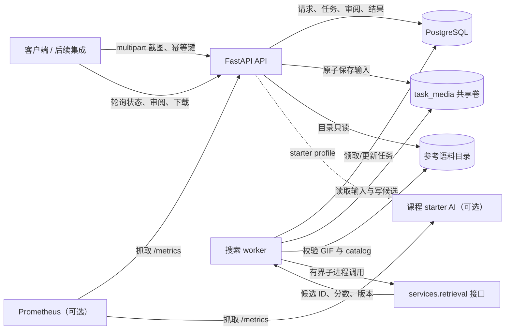

# 后端、数据与部署：开发日志和架构说明

> **负责人：** Haoxuan Jiang（21313230）
> **工作范围：** FastAPI 契约、PostgreSQL schema 与迁移、持久化任务与幂等、共享存储、Docker 部署和后端验证。
> **记录范围：** W07 后端实现及后续运行可靠性、容器安全加固。

这份文档面向组员、课程评审和后续接手者，说明后端为什么这样拆分、一次搜索如何从请求走到结果，以及本部分开发中逐步完成了哪些工程工作。它是实现说明和开发记录，不代表客户端、真实检索模型或设备端验证已经完成。

## 1. 后端要解决什么问题

MemeRetrieve 的后端需要接收客户端提交的截图裁剪图，快速确认请求已持久化，然后在后台检索参考 GIF，保存候选结果，并让客户端能够查询、审阅、重试和读取媒体。

这里有两个不同的成功边界：

1. **请求已接受：** 输入文件、搜索请求和首个任务都已保存；API 返回 `202 Accepted`。
2. **搜索已完成：** worker 已写入候选或明确的无结果状态，或者记录可检查的失败原因。

因此 API 不等待模型推理结束。任务状态和文件路径由服务端持久化，客户端可以在稍后查询，而不需要保持一次长 HTTP 请求。

## 2. 系统架构



### Compose 服务分层

| 服务 | 默认启动 | 职责 |
|---|---:|---|
| `db` | 是 | PostgreSQL；保存 API 数据、任务状态、语料 catalog 和审阅 |
| `api` | 是 | HTTP 契约、输入校验、文件存储、状态查询和 Alembic 升级 |
| `worker` | 是 | MemeRetrieve 搜索队列、受限检索调用、候选验证和媒体清理 |
| `ai`、`starter-worker` | `starter` profile | 保留课程 case/AI triage 流程，不与搜索任务表混用 |
| `prometheus` | `observability` profile | 抓取 API 和 starter AI 的 metrics；该 profile 同时启动 AI |

`cases/jobs` 是课程 starter 的 triage 数据链；`search_requests/search_jobs` 是 MemeRetrieve 的搜索链。它们是两套独立契约和队列。

默认部署通过 Compose 网络让 API、数据库和 worker 内部通信；主机端口默认只绑定 loopback。API、AI 和 worker 使用 UID `10001`，应用容器移除 Linux capabilities 并禁止提权。媒体、模型缓存和 Prometheus 数据使用命名卷；参考语料由宿主机目录提供，并以只读方式挂载给 API 和搜索 worker。

## 3. 一次搜索的生命周期

### 3.1 接收与持久化

`POST /search-requests` 接收 multipart 图片和 `client_submission_key`：

1. 限制上传字节数，并解码校验 JPEG、PNG 或 WebP；同时约束像素数。
2. 计算输入 SHA-256，并检查幂等键是否已存在。
3. 将输入写入共享卷中的临时文件，`fsync` 后原子改名。
4. 在一个数据库事务中新增 `SearchRequest` 和首个 `SearchJob`。
5. 数据库提交成功后返回 `202` 和 request/job ID；提交失败时回滚并清理尚未被引用的文件。

同一个提交键只有在图片内容、关键词和客户端 item ID 均相同时才重放原请求；键相同但内容不同则返回 `409`。数据库唯一约束负责处理并发请求的最终竞争，而不是依赖“先查询再插入”的单机假设。

### 3.2 worker 领取和检索

搜索 worker 使用 PostgreSQL `FOR UPDATE SKIP LOCKED` 领取一条 `pending` 工作，并在短事务内转为 `running`。这样即使错误地启动多个实例，也不会同时领取同一条队列记录；另外，PostgreSQL advisory lock 将部署约束为单个搜索 worker，并在进程退出时释放。

检索在数据库事务之外执行。worker 校验输入文件 checksum 后，将路径交给 `services.retrieval.search(image_path, top_k=3)` 子进程接口。子进程有超时限制，返回值按严格 schema 校验：最多三个候选、ID 不重复、分数有限且按降序排列，并携带模型与语料版本。

目前真实检索包、权重和经许可的参考语料由检索负责人提供。若接口尚不可用，任务明确失败为 `retrieval_unavailable`；不会用虚构候选或测试数据伪装成真实搜索结果。

### 3.3 候选落盘与结果提交

worker 会确认每个候选 ID 存在于声明的语料版本，并重新读取 GIF 验证格式、帧数、大小和 checksum。候选媒体先原子写入共享卷，再和任务完成状态在一个数据库事务中提交。

候选表只保存内部相对路径；API 返回候选 ID、排序、分数和媒体 URL，不向客户端暴露容器绝对路径。媒体接口在返回文件前检查候选存在、有效期和磁盘文件状态。

### 3.4 状态、失败和恢复

搜索任务状态为：

```text
pending -> running -> completed
                   -> failed
```

`completed` 可区分 `candidates` 与 `no_candidates`；无匹配是有效业务结果，不是技术故障。失败返回稳定错误 code 与适合客户端显示的 detail。

worker 启动时，在取得单实例 advisory lock 后，将遗留的 `running` 任务标记为 `worker_interrupted`，保留失败历史；用户显式 retry 时创建新的 attempt，不把旧任务改回 pending。接收 SIGTERM/SIGINT 后，搜索 worker 不再开始新任务；若正在处理，则允许当前有界检索及结果落库路径结束，再释放 advisory lock。Compose 默认停机宽限期为 150 秒，对应 120 秒默认检索超时并预留数据库收尾时间。

## 4. 数据与一致性设计

核心搜索实体及关系：

```text
SearchRequest 1 ── N SearchJob（按 attempt_no 留存重试历史）
SearchJob     1 ── N Candidate
ReferenceAsset 1 ── N Candidate
SearchJob     1 ── N ReviewDecision
```

- **`SearchRequest`**：客户端提交键、输入文件相对路径与 checksum、可选关键词和 item ID。
- **`SearchJob`**：每次尝试的状态、开始/结束时间、结果类型、模型/语料版本和错误信息。
- **`ReferenceAsset`**：语料 ID、GIF checksum、许可/来源说明、相对路径、帧数和语料版本。
- **`Candidate`**：某次 job 的排序结果、有限分数、GIF transport 文件路径和过期时间。
- **`ReviewDecision`**：用户对某次已完成 job 的接受或全部拒绝决定。

Alembic revision 将 ORM 定义的表结构迁移到 PostgreSQL。除了应用层校验，数据库也用唯一约束、外键、check constraint 和部分索引保证关键不变量，例如 attempt 唯一、每个请求最多一个活动任务、候选 rank 范围、审阅候选必须属于同一 job、任务状态与时间戳组合合法。

可重复操作通过不同层次保障：

- 上传：`client_submission_key` 唯一；同内容重放，不同内容冲突。
- 审阅：`client_review_key` 唯一；重放返回原决定，不能改变其 job 或选择。
- 重试：`client_retry_key` 唯一；每次重试新增 attempt，失败历史保留。
- worker 领取：行锁跳过已锁记录；实例级 advisory lock 避免双 worker 启动恢复冲突。

## 5. API 契约速查

所有搜索 ID 均为 UUID 字符串；JSON 字段为 snake_case。搜索、候选、审阅和 retry 路由可由 `DEVICE_TOKEN` 保护。

| 方法和路径 | 用途 | 成功结果 |
|---|---|---|
| `POST /search-requests` | 上传图片并创建持久化任务 | `202`，返回 request/job ID 与状态 |
| `GET /search-requests/{request_id}` | 查询最新 attempt、候选和错误 | `200` |
| `GET /search-jobs/{job_id}/candidates` | 查询指定 attempt 的候选 | `200` |
| `GET /candidates/{candidate_id}/media` | 读取候选动画 | `image/gif` |
| `POST /search-jobs/{job_id}/reviews` | 提交接受或全部拒绝决定 | `201` |
| `POST /search-requests/{request_id}/retry` | 对失败请求创建新 attempt | `202` |

上传、审阅与 retry 的幂等语义及错误响应详见[后端运行指南](backend-guide.md#client-contracts)。

## 6. 共享文件存储与保留

数据库不保存图片二进制；API 和 worker 通过同一个 `task_media` 卷交换上传输入及候选 GIF。文件名采用服务端生成的 ID/相对路径，写入时先生成临时文件并原子替换。路径解析会确认结果仍处于预期根目录内，避免路径穿越。

参考 GIF 和 manifest 与临时任务媒体分开：catalog 元数据导入 PostgreSQL，宿主机语料目录只读挂载；每个文件在导入前检查动画 GIF 和 SHA-256。临时输入/候选文件按保留期清理；活跃任务使用中的输入不会被误删，清理失败会记日志并留待后续清理。

本地执行 `docker compose down` 保留命名卷；`docker compose down -v` 会删除数据库、任务媒体、模型缓存和 Prometheus 数据卷，不能把它当作无害的普通停止命令。

## 7. 开发日志

以下按实现主题记录交付内容，不代表真实模型、客户端或设备端已经完成：

### 阶段 A：定义服务边界与契约

- 保留课程 starter 的 case/AI triage 路径，为 MemeRetrieve 新建独立搜索路由和数据模型。
- 定义 multipart 上传、状态查询、候选媒体、审阅和失败后 retry 契约。
- 用稳定错误 code 区分输入错误、媒体缺失、检索不可用与 worker 执行失败。

### 阶段 B：建立持久化与幂等

- 用 SQLAlchemy 描述搜索请求、任务尝试、语料 asset、候选与审阅。
- 用 Alembic 管理数据库升级与回退；增加数据库层状态、外键、唯一性和候选约束。
- 使用唯一幂等键和事务应对重复及并发提交；retry 创建新 attempt，保留审计历史。

### 阶段 C：实现文件与语料数据路径

- 校验图片字节数、解码格式、像素量及 GIF 帧数/总解码工作量。
- 以 SHA-256 确认上传输入和 catalog GIF；通过原子写入与共享卷支持 API/worker 分离。
- 实现 manifest 导入、来源/许可字段校验、分批数据库查找和重复导入保护。
- 实现输入/候选文件过期与孤儿清理，并让只读语料目录通过 API readiness 检查。

### 阶段 D：实现异步 worker 与故障语义

- 使用短数据库事务领取任务；检索与文件操作不占用领取事务。
- 通过受限子进程协议调用外部检索实现；限制执行时间和返回结构。
- 结果完成时一并保存候选元数据；中断任务显式标记失败，要求用户发起新 attempt。
- 增加单实例 advisory lock、SIGTERM/SIGINT 优雅停机及与检索上限匹配的 Compose 停机宽限期。
- 为课程 starter worker 增加单实例保护和 `claimed` 任务重启恢复，避免两条队列都留下永久卡住的工作。

### 阶段 E：部署安全与运行验证

- 用 Compose 区分默认搜索栈、starter 与 observability profiles；为数据库密码设置必填项，端口默认 loopback。
- 使用只读参考语料挂载、命名卷、日志轮转与 Prometheus 保留限制。
- 应用容器移除 Linux capabilities、禁止提权，并以非 root UID `10001` 运行；初始化媒体和模型卷目录权限。
- 验证 API readiness、worker 执行、数据库迁移、并发幂等、搜索 smoke、容器重启恢复、优雅停机和卷权限。

## 8. 当前验证结果与明确边界

最近一次代码级验证：

- `pytest -q -W error`：**51 passed，6 skipped**。
- `ruff check .`、依赖兼容检查和 `git diff --check` 通过。
- SQLite 集成测试覆盖 API 契约、状态处理、文件存储和 worker 行为；可选 PostgreSQL/部署 smoke 用例在未提供相应环境变量时会跳过。
- 临时 Compose 实测确认非 root 容器可访问共享卷、case/AI starter 可处理任务，Prometheus 可就绪；搜索 worker 收到 SIGTERM 后正常退出。

以下事项不在“已验证完成”的范围内：

1. 真实 `services.retrieval` 包、预训练权重、合法语料和检索质量评估仍需检索负责人集成；`retrieval_unavailable` 是当前明确的边界行为。
2. Web/iOS 客户端、手机保存与播放验证由客户端负责人负责。
3. 当前 API 有需要认证的搜索操作和本地 token 配置，但仍有未认证的 legacy starter/health 路由；该部署定位是本地开发栈，不是互联网生产服务。
4. PostgreSQL 专项并发/迁移测试需设置 `TEST_POSTGRES_URL`；部署 smoke 需提供 `SMOKE_BASE_URL` 才会执行。

## 9. 相关源码入口

| 内容 | 文件 |
|---|---|
| API 入口、case/starter routes、health/readiness | [`services/api/app/main.py`](../services/api/app/main.py) |
| MemeRetrieve HTTP 契约、幂等、retry、review、媒体读取 | [`services/api/app/search.py`](../services/api/app/search.py) |
| ORM、数据库连接和迁移 | [`services/common/search_models.py`](../services/common/search_models.py)、[`alembic/versions/`](../alembic/versions/) |
| 请求/响应 schema 与共享媒体校验 | [`services/common/search_schemas.py`](../services/common/search_schemas.py)、[`services/common/storage.py`](../services/common/storage.py) |
| 参考语料 manifest 导入 | [`services/common/reference_assets.py`](../services/common/reference_assets.py) |
| 搜索 worker 和检索子进程协议 | [`services/worker/app/search_worker.py`](../services/worker/app/search_worker.py)、[`services/worker/app/retrieval_runner.py`](../services/worker/app/retrieval_runner.py) |
| starter case/AI worker | [`services/worker/app/main.py`](../services/worker/app/main.py) |
| 容器身份、部署服务、数据卷和 profiles | [`Dockerfile`](../Dockerfile)、[`compose.yaml`](../compose.yaml) |
| 启动参数、API 契约和运维验证 | [`后端运行指南`](backend-guide.md) |
