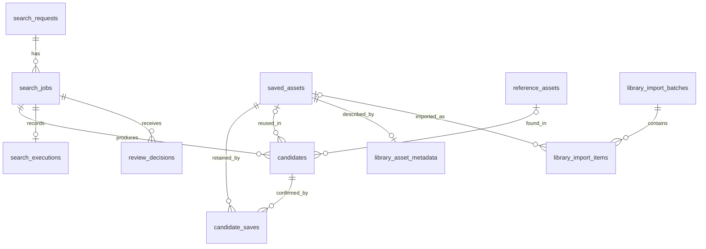

# MemeRetrieve 数据库与向量检索设计

PostgreSQL 16 保存账户、任务、收藏和索引状态，共享媒体卷保存原始 GIF。固定 CLIP 产生 512 维图像帧向量。产品 Docker 配置使用 pgvector 执行精确匹配，现有 NPZ 文件同时充当可验证的持久备份与检索回退。原件、账户和 API 标识沿用原格式。[部署与升级](product-deployment.md)

## 已实现的关系数据

下图是每个 workspace 内的主要关系。一次本地检索和后续联网检索共享同一请求 ID；用户收藏产生独立的资产 ID，后续离线候选可以再次指向这个资产。

| 数据 | 关联与约束 |
| --- | --- |
| `library_accounts`、`library_sessions`、`library_owner_setup` | 部署库的全局注册表。用户名为主键，workspace 唯一。会话表存令牌摘要并引用账户，对过期时间建索引。初始原库绑定凭据按摘要校验、一次使用并过期。 |
| `search_requests`、`search_jobs` | 一个请求可有本地搜索、联网补搜及重试。请求记录输入 SHA 和存储路径。提交键、补搜键、重试键处理重复请求。每请求的 attempt 序号唯一，部分唯一索引限制同一请求只有一个 pending/running 任务。worker 用 `FOR UPDATE SKIP LOCKED` 领取，按状态与创建时间排队。 |
| `candidates`、`reference_assets` | 候选归于任务。同任务的 rank 与内容分组分别唯一。候选可指向参考 GIF 或已收藏资产，也可指向实际下载并验证的媒体。参考清单记录语料版本、来源与 SHA。 |
| `search_executions`、`meme_candidate_drafts`、`meme_progress_events` | 执行记录与任务一对一，保存调用数、耗时、停止原因和 trace。草稿键与事件序号各在任务内唯一。正式结果事务发布，查询通过 result revision 读取稳定结果。 |
| `review_decisions`、`candidate_saves`、`saved_assets` | 审阅记录约束已选候选属于相同任务。收藏回执用客户保存键去重。收藏资产对 SHA 唯一，每个库独立计算，文件按内容寻址。原文件持久化后记录 `pending` 索引状态，与素材保存分开。 |
| `library_import_batches`、`library_import_items`、`library_asset_metadata`、`library_similarity_scans` | 导入按批次键与清单摘要绑定。每批子项以 `(batch_id, client_item_id)` 唯一，成功或重复项都引用稳定资产 ID。人工字段、需同意的 AI 标注和近重报告各随资产维护。 |

关系模型和迁移是校验依据。 [任务、候选与资产模型](../services/common/search_models.py) · [私有库模型](../services/common/library_models.py) · [账户注册表](../services/common/accounts.py)

## 账户和生命周期

开启 `ACCOUNT_LOGIN_ENABLED` 后，API 根据随机会话令牌的摘要查找有效账户，再由服务端选定 workspace。请求携带的账号标识只用于检测页面会话是否已经切换。PostgreSQL 的公共注册表和原单用户库位于 `public`。新账户使用 `acct_<uuid>` 独立 schema 和 `MEDIA_ROOT/accounts/<workspace>`，SQLite 开发环境则使用该目录下的独立数据库文件。账号数据库连接只查自己的 schema，worker 按已登记 workspace 扫描队列。原单用户库可由部署者使用有时效的 owner setup 绑定，资产和索引路径沿用原路径。固定参考素材与模型权重是共享只读资源，参考资产关系在开户时复制，语料变更要同步已有 schema 的参考元数据。 [账户中间件](../services/api/app/accounts.py) · [workspace 配置](../services/common/config.py) · [账户创建](../services/common/accounts.py)

当前隔离依赖应用层会话路由、schema 搜索路径和媒体根。数据库运行角色仍能拥有多个 schema 的访问权限。公开部署若要求数据库层隔离，应另行设计最小权限、开户角色和迁移角色，验证默认权限与 `search_path` 后再部署。所有新向量入口都应继承同一 workspace 路由以及资产授权边界。 [PostgreSQL 16 schema 与权限](https://www.postgresql.org/docs/16/ddl-schemas.html)

任务输入和候选媒体有默认 7 天保留窗口。worker 跳过仍有活动任务或近期完成任务的输入，清理过期候选原媒体以及已到期、任务不活跃的草稿，扫除超过一天的无引用文件。收藏原件及其当前索引独立保留。候选元数据、已发布预览、旧索引版本和任务 trace 没有完整的自动删除策略，需另定保留期。若增加主动删除，建议先把资产和所有代索引标为不可检索，在事务内处理导入与收藏回执的引用关系，再由可重试的清理任务去除文件和衍生向量。对历史任务应保留明确的已删除状态，既有幂等键不得复活原资产。 [worker 清理](../services/worker/app/search_worker.py) · [收藏文件发布锁](../services/common/saved_publish.py)

## 已实现的向量读写

CLIP 模型为 `openai/clip-vit-base-patch32`，修订 `37000f5cdccec47a3f6f83142bff131370757470`。权重预先下载，运行时从本机加载。图像转 RGBA 后叠白底进入编码器，输出 512 维、L2 归一化的 `float32`。每个 GIF 均匀抽取至多 8 帧，包含端点。参考库使用 `gif-frames.npz`，保存语料清单摘要、语料与模型版本、帧序号、素材 ID 和矩阵。W07 的 12 个参考 GIF 有 96 个向量。 [编码器](../services/retrieval/encoder.py) · [参考索引与查询](../services/retrieval/engine.py) · [W07 运行说明](local-demo.md)

收藏或导入把原字节和元数据持久化后，worker 领取索引任务。校验原件 SHA、大小和帧数，生成 `saved-index/<asset_id>/<index_version>.npz` 并原子发布。版本绑定资产 ID、原件 SHA、模型、文件格式、采样版本和帧数。写后重读校验通过才更新为 `ready`，失败保留原资产并可重试。程序重启将中断的索引标为失败。ZIP 用户备份搬运原 GIF 和选定元数据，目的库通过任务重建向量。 [收藏索引](../services/retrieval/saved_index.py) · [索引状态转换](../services/worker/app/search_worker.py)

本地搜图对新截图编码，读取固定矩阵与当前库的 ready 收藏向量。收藏读取时检查 NPZ 形状、有限值、版本和原文件 SHA，遇到坏索引则跳过并记录日志。精确归一化点积按 GIF 的最高帧分聚合，按得分降序、ID 排序处理并列，最多返回 3 个资产。实验阈值默认 `0.82`，分数是相似度。私有库的文字查询走标题、人工标签、OCR 及语义规则，联网补搜对实际下载候选单独计算临时表示与重排。两者的评测与本地图像向量索引分开。 [私有库查询](../services/api/app/library.py) · [外网媒体排序](../services/search_agent/meme_pipeline.py)

## 容量与演进条件

每个向量裸数据 2 KiB，8 帧约 16 KiB/GIF。2,000 个八帧收藏约 31.25 MiB，10,000 个约 156.25 MiB，尚未计入 NPZ、解压矩阵、评分临时数组和媒体读取。精确排序复杂度随候选帧数线性增长。当前每次查询启动独立子进程并从本机加载模型，逐收藏打开 NPZ、重新读取和哈希完整 GIF。应将队列等待、模型启动与编码、索引打开与原件校验、相似度计算分别计时，再针对实测耗时优化。

建议用同一部署硬件和固定截图集，测量每账户 100、1,000、5,000、10,000 个收藏，记录冷启动、热运行、并发 1 和 4 的 P50/P95、RSS、磁盘读取量、失败率及索引就绪耗时。相同查询比较原 GIF SHA、Top-3 ID、阈值边缘、零候选和同分结果。下列门槛是试验决策值，待实测校准。

| 触发条件 | 演进动作 |
| --- | --- |
| 主要耗时来自模型冷启动或文件校验 | 优先评估受控进程复用、按 workspace 切换的矩阵快照、批量校验或后台完整性核验。保留原件 SHA、变更检测及下载时验证。 |
| 目标规模的热索引读取与评分 P95 连续超出 300 ms，且已成为端到端主要耗时 | 在克隆库试验 pgvector 的精确检索。建议在固定基准上达到至少 30% 热检索 P95 改善，同时保持同一阈值语义与近乎一致的排序。 |
| 精确 pgvector 仍超出预算 | 试验 HNSW。建议独立留出集达到资产级 Recall@3 至少 0.98，精确原 GIF 命中不得下降，且端到端 P95 有可重复收益。有候选不足或版本不完整的情况回退到精确搜索。 |

每次比较都核对租户隔离、索引完整、备份还原和磁盘成本。单账户媒体目录、每账户迁移和单 worker 顺序轮询有各自的扩容边界。向量索引对队列调度和关系表访问没有直接收益。

## PostgreSQL 图像帧与动画检索

每个索引条目是一张图像帧的 512 维 CLIP 向量。动画 GIF 取最多八张代表帧，离线搜索把用户的新截图编码为查询向量，对每个 GIF 取最高帧分，再按素材返回 Top-3。用户上传的截图使用现有任务输入保留期，检索向量在请求内计算。私人库的收藏与导入接收原始动画 GIF。

| 存储 | 范围与约束 |
| --- | --- |
| 公共参考图像帧 | 镜像固定语料的图像帧。参考语料版本、清单 SHA 和模型修订共同约束当前可读的向量。由部署者构建参考索引后更新。 |
| `saved_vector_versions` | 当前工作空间的资产 ID 和索引版本作为主键，版本行保存原件 SHA 与预期帧数；删除资产时级联清除衍生数据。 |
| `saved_frame_vectors` | 当前工作空间的资产 ID、索引版本和帧序号作为主键，向量类型为 `vector(512)`。整组帧和版本一起提交。 |

PostgreSQL 用准确的余弦距离计算帧分、按资产取最高分。扩展不可用、向量不完整、版本不符或数值临界可能影响顺序时，查询回退到经过校验的 NPZ。原件读取继续校验 SHA，参考和私人收藏的 NPZ 文件及文件格式都保持兼容。规模增长后可用前述基准判断是否需要 HNSW。[pgvector 精确与近似检索](https://github.com/pgvector/pgvector#indexing)

## 升级、回退和验证

升级前暂停写入，同一时间点备份整个 PostgreSQL 和媒体卷。既有 Compose 的 PostgreSQL 数据用逻辑备份导入独立的 pgvector 卷，保留迁移前账户和原文件路径。数据库迁移对 PostgreSQL 的已注册 workspace 逐个执行，无扩展的部署继续以 NPZ 运行。

部署者启用扩展后运行 provision，再用保存的旧 NPZ 回填各私人 workspace。回填校验原字节和索引版本，保持资产 ID、原件路径和收藏状态。运行参考索引命令同步固定语料的帧向量。配置 `VECTOR_BACKEND=npz` 并重启 worker 可立即切回文件索引，媒体和关系数据继续由相同卷提供。[运行命令与备份步骤](product-deployment.md)
