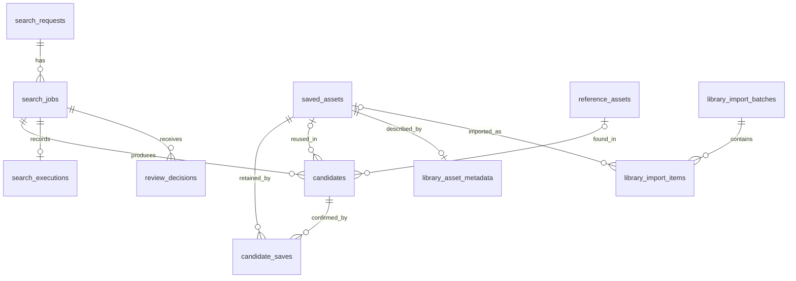

# Database and vector search

[简体中文](../database-and-vector-search.md) · [Technical guide](README.md)

PostgreSQL 16 stores accounts, tasks, collections and index state. A shared media volume holds the original GIFs. A pinned CLIP encoder produces 512-dimensional image-frame vectors. The product Compose configuration uses exact pgvector search and keeps the versioned NPZ files as a verifiable fallback. Existing account, asset and API identifiers survive migration. [Deployment and upgrade guide](../guides/product-deployment.md)

## Relational data

A local search and its online continuation share a request ID. Saving a candidate creates or reuses a durable asset ID. Later local searches can return a candidate that refers to that asset. These relationships apply within a workspace.

| Tables | Relationships and constraints |
| --- | --- |
| `library_accounts`, `library_sessions`, `library_owner_setup` | The deployment-wide registry uses the username as primary key and assigns a unique workspace. Sessions reference accounts and store token digests and indexed expiry times. The single-use credential for claiming a pre-account library expires and is checked by digest. |
| `search_requests`, `search_jobs` | A request records the input SHA and path and can have a local job, an online job and retries. Submission, continuation and retry keys handle repeated requests. Attempt numbers are unique within a request. A partial unique index allows one pending or running job per request. Workers claim jobs using `FOR UPDATE SKIP LOCKED` and queue them by state and creation time. |
| `candidates`, `reference_assets` | Rank and content group are each unique per job. Candidates refer to catalog GIFs, saved assets or media retrieved and verified by the online job. The reference manifest records corpus version, provenance and SHA. |
| `search_executions`, `meme_candidate_drafts`, `meme_progress_events` | Each execution belongs to one job and stores call counts, duration, stop reason and trace. Draft keys and event sequence numbers are unique per job. A transaction publishes the results under a stable result revision. |
| `review_decisions`, `candidate_saves`, `saved_assets` | The reviewed candidate must belong to the reviewed job. A client save key deduplicates a save receipt. Each library deduplicates assets by SHA and stores original files by content hash. The asset enters `pending` indexing after the original is persisted. |
| `library_import_batches`, `library_import_items`, `library_asset_metadata`, `library_similarity_scans` | An import batch key binds to a manifest digest. Each item is unique by `(batch_id, client_item_id)`. Imported and duplicate items both refer to a stable asset ID. Manual fields, consent-based AI annotations and near-duplicate reports belong to the asset. |

The ORM models and Alembic migrations define the schema. [Search models](../../services/common/search_models.py) · [Private library models](../../services/common/library_models.py) · [Account registry](../../services/common/accounts.py) · [Migrations](../../alembic/versions)

## Accounts and data lifecycle

With `ACCOUNT_LOGIN_ENABLED` enabled, the API looks up the digest of the random session token, checks expiry and chooses the workspace on the server. An account name sent by the browser detects changes of session in another tab. PostgreSQL's global registry and original single-user library live in `public`. New accounts use a separate `acct_<uuid>` schema and `MEDIA_ROOT/accounts/<workspace>`. SQLite development environments use a separate database file in that directory. Account connections use their own schema search path. The worker visits registered workspaces to process their queues. An operator can bind an existing single-user library with an expiring owner-setup code and keep its asset and index paths. Reference files and model weights are shared read-only resources. Provisioning copies the reference rows into each new account. A later catalog change also requires synchronizing reference metadata in existing schemas. [Account middleware](../../services/api/app/accounts.py) · [Workspace settings](../../services/common/config.py) · [Account provisioning](../../services/common/accounts.py)

Session routing, schema search paths and separate media roots provide application-level isolation. The deployed database role can have access to several schemas. A deployment that needs independent database permission boundaries should design provisioning, migration and application roles and verify their default privileges and search paths. New vector reads and writes must use the same workspace selection and asset authorization. [PostgreSQL 16 schema privileges](https://www.postgresql.org/docs/16/ddl-schemas.html)

The default retention window for task inputs and candidate media is seven days. The worker preserves inputs for active or recently completed jobs. It cleans expired candidate media, expired drafts from inactive jobs, and unreferenced files older than one day. Saved originals and their current indexes persist independently. Candidate metadata, published previews, old index versions and traces still need explicit retention policies. A future asset-deletion implementation should first make the asset and all derived versions ineligible for search. It should reconcile references from imports and save receipts transactionally, then remove files and vectors using a retryable cleanup job. Historical jobs should retain an explicit deleted state so replaying an old key cannot revive the asset. [Worker cleanup](../../services/worker/app/search_worker.py) · [Atomic saved-file publication](../../services/common/saved_publish.py)

## Encoding, publication and ranking

The encoder is `openai/clip-vit-base-patch32` at revision `37000f5cdccec47a3f6f83142bff131370757470`. Weights are downloaded during setup and loaded locally for inference. Each image is converted to RGBA and composited onto white. The encoder returns an L2-normalized 512-dimensional `float32` vector. Sampling selects up to eight evenly spaced frames per GIF, including the endpoints. The shared `gif-frames.npz` binds its matrix, asset IDs and frame numbers to the manifest digest, corpus version and model version. The 12-GIF reference catalog has 96 frame vectors. [Encoder](../../services/retrieval/encoder.py) · [Reference indexing and queries](../../services/retrieval/engine.py)

After a save or import persists the bytes and metadata, the worker claims an index job. It verifies the original SHA, byte count and frame count, then publishes `saved-index/<asset_id>/<index_version>.npz` atomically. The version binds the asset ID, original SHA, model, index format, sampling version and frame count. A read-back check precedes the transition to `ready`. Failures leave the original available for retry. A restart marks interrupted indexing as failed. ZIP library backups transport originals and selected metadata. The destination library rebuilds the derived vectors after import. [Saved indexes](../../services/retrieval/saved_index.py) · [Worker state transitions](../../services/worker/app/search_worker.py)

Local retrieval encodes the query screenshot and searches the fixed catalog and the current workspace's ready assets. Reading a saved NPZ validates its shape, finite values, version and original GIF hash. An invalid entry is skipped and logged. On normalized embeddings, the best frame score becomes the GIF score. Results are ordered by descending score and then by asset ID and limited to three qualifying GIFs. The default cutoff `0.82` measures similarity. Text search inside the private library uses titles, manual tags, OCR and semantic rules. Online retrieval computes temporary representations for fetched media and reranks those candidates separately. [Library text search](../../services/api/app/library.py) · [Online ranking](../../services/search_agent/meme_pipeline.py)

## Size and performance

A 512-dimensional `float32` vector uses 2 KiB. Eight vectors use 16 KiB per GIF. The raw vectors for 2,000 such GIFs occupy 31.25 MiB and 10,000 occupy 156.25 MiB. File containers, SQL rows, temporary scoring matrices and media I/O add overhead. Exact search scales linearly with eligible frames. Each search currently launches a subprocess and loads the local model. The saved-NPZ path opens each eligible index and checks the full original. The pgvector path verifies frame coverage and checks the originals of the saved matches. Measure queue wait, model load and encoding, index I/O and original validation, and scoring separately.

For capacity planning, a proposed benchmark uses the same host and screenshot set with 100, 1,000, 5,000 and 10,000 saved GIFs per account. Measure cold and warm P50/P95 latency at concurrency 1 and 4, RSS, disk reads, failures and time to index readiness. Compare original-file SHAs and Top-3 IDs, including threshold edges, empty results and ties. The figures below are proposed decision thresholds.

| Measured condition | Experiment |
| --- | --- |
| Model cold starts or file verification dominate latency | Evaluate controlled process reuse, per-workspace matrix snapshots, batch verification or background integrity checks. Preserve change detection, SHA identity and validation on download. |
| Warm reads and scoring repeatedly exceed 300 ms P95 at the target size and dominate end-to-end latency | Compare the implemented exact pgvector and NPZ paths on a clone. Look for at least a 30% improvement in warm retrieval P95 while preserving the threshold semantics and equivalent ordering. |
| Exact pgvector still exceeds the agreed budget | Test HNSW. A proposed gate is asset-level Recall@3 of at least 0.98 on an independent holdout, stable exact-original recovery and repeatable end-to-end P95 improvement. Use exact search when candidate sets or versions are incomplete. |

Also measure tenant isolation, index completeness, backup restoration and disk cost. Per-account media directories, schema migrations and sequential workspace polling have separate scaling limits.

## PostgreSQL frame storage

Each image-frame entry is a 512-dimensional CLIP vector. One GIF contributes up to eight representative frames. A new query vector is computed for each screenshot and used within the request. The uploaded screenshot follows task-input retention. The private library retains the original animated GIF supplied by save or import.

| Storage | Scope and constraint |
| --- | --- |
| `public.reference_vector_generations`, `public.reference_frame_vectors` | The shared mirror binds each published catalog to its manifest SHA, corpus version and model revision. Building the reference index refreshes this generation. |
| `saved_vector_versions` | Workspace-local primary key on asset ID and index version. Each row records the original SHA and expected frame count. Asset deletion cascades to the derived records. |
| `saved_frame_vectors` | Workspace-local primary key on asset ID, index version and frame number, with a `vector(512)` embedding. The version and its complete frame set commit together. |

PostgreSQL computes exact cosine distance per frame and groups by asset to select the best score. If the extension is unavailable, coverage is incomplete, a version mismatches or rounding at a threshold or tie could change the order, the retrieval engine falls back to verified NPZ data. The original is still checked against its SHA. Both reference and private NPZ files remain compatible with existing deployments. [Database implementation](../../services/retrieval/vector_store.py) · [Exact and approximate pgvector indexing](https://github.com/pgvector/pgvector#indexing)

## Migration, rollback and verification

Before upgrading, pause writes and back up PostgreSQL and the media volume at the same point in time. Restore an existing Compose database logically into a separate pgvector volume. Retain the old accounts, asset paths and original database volume. Alembic applies relevant migrations to registered PostgreSQL workspaces. A deployment without the extension can continue with NPZ.

After enabling the extension, run `python -m services.retrieval.vector_store provision`. Backfill each workspace with `python -m services.retrieval.saved_index --workspace <workspace>` using the saved NPZ files. The backfill checks original bytes and index versions and preserves asset IDs, paths and collection state. Run `python -m services.retrieval.engine index` to mirror the reference frames. To switch retrieval back to NPZ, set `VECTOR_BACKEND=npz` and recreate the worker with the same database and media volumes. [Installation and migration commands](../guides/product-deployment.md) · [Old-data migration, fallback and download evidence](../../submissions/week13/pgvector-verification.json)
